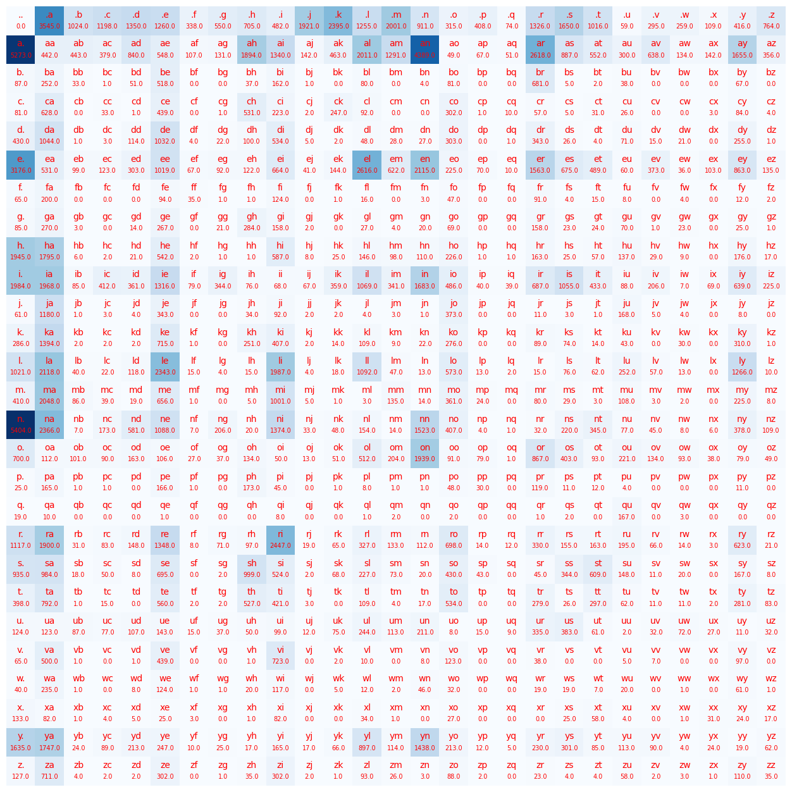

# Bigram_Trigram_name_generator

Bigram and trigram language models built from scratch in PyTorch. They learn from 32,033 names, generate new ones, and are evaluated with the same objective GPT is trained on: average negative log-likelihood of the next character.
 

 
## Results
 
80/10/10 shuffled split (seed 42). Smoothing k was chosen on the validation set, and the test set was evaluated once at the end.
 
| Model | Context | Train NLL | Val NLL | Test NLL | Test perplexity |
| --- | --- | --- | --- | --- | --- |
| Uniform (baseline) | none | 3.296 | 3.296 | 3.296 | 27.0 |
| Bigram, k = 0.1 | 1 character | 2.454 | 2.453 | 2.458 | 11.7 |
| Trigram, k = 0.1 | 2 characters | 2.187 | 2.223 | 2.224 | 9.2 |
 
NLL is in nats per character (lower is better). Perplexity = e^NLL, the effective number of equally likely choices per character.
 
**Takeaways**
- More context helps: the trigram cuts the uncertainty per character from about 12 choices to about 9.
- More context also overfits more. The train–validation gap grows from ~0.001 (bigram) to ~0.035 (trigram), because 182K training predictions are spread over 595 observed trigram contexts instead of 27 bigram contexts.
## Samples
 
Ten samples from each model (k = 0.1), next to a uniform random baseline:
 
| Bigram | Trigram | Uniform random |
| --- | --- | --- |
| anugeenvi | nat | xjugueovtps |
| mabidushan | syna | epjccuodsgjdmzu |
| stan | idushante | welqxosvgkocobr |
| silaylelaremah | silayley | pjjiewx |
| li | kemah | lhmjuhm |
| epiachalen | lucin | uklnncvrigmydysoumf |
| diza | epiah | fsckbirdovhgn |
| jondry | jordon | atodr |
| kanck | kence | bxwqljcdq |
| miqulynaya | miqueyjaya | tmdampezaqj |
 
Uniform samples are gibberish and run long: each step stops with probability only 1/27, so they average about 26 characters. Bigram names look name-like only locally. Trigram names are more often pronounceable (jordon, lucin, kemah).
 
## Bigram counts
 

 
Each cell counts how often the column character follows the row character in the 25,626 training names. `.` marks the start (row) and end (column) of a name. The darkest cells are `n.` (5,404) and `a.` (5,273): many names end in n or a. The most common first letter is a (`.a`, 3,545).
 
## Method
 
1. **Data.** 32,033 lowercase names. Vocabulary of 27 tokens: a–z plus `.`, which marks both the start and the end of a name. The file is sorted by popularity, so it is shuffled before splitting.
2. **Training.** Count every bigram (or trigram) in the training names, padding each name with `.` (or `..` at the start for trigrams). Normalising each context's row gives P(next | context). For this model, normalised counts are the maximum-likelihood estimate, so counting *is* training.
3. **Sampling.** Start from the all-`.` context, sample the next character from its row, slide the context window, and stop when `.` is sampled.
4. **Evaluation.** Average negative log-likelihood over every prediction (name length + 1 per name). Logs turn the product of probabilities into a sum and avoid numerical underflow.
5. **Smoothing.** Unseen n-grams get probability 0 and an infinite loss. Add-k smoothing adds k to every count. k = 0 always wins on training data, so k is tuned on the validation set: small k trusts the data's quirks, huge k collapses to uniform guessing.
## What I learned
 
- **Splitting matters.** Training loss only shows memorisation; validation loss is what decides k. With k = 0, validation loss is infinite for the bigram (unseen pairs) and NaN for the trigram (unseen contexts give 0/0).
- **Known-answer tests catch bugs that plausible numbers hide.** Training on `["abcdefgh"]` must give a loss of exactly 0 and samples equal to "abcdefgh". Tests like this exposed a sampler that reset its context, a loss loop that ignored its loop variable, and an off-by-one in the prediction count that passed a single-name test.
- **Mutation bugs are silent.** `N += k` and `random.shuffle(data)` changed the original data in place, so re-running notebook cells changed results without any error.
- **Padding removes special cases.** Wrapping names in `.` replaced separate start/end logic, which was where most of the bugs came from.
## Limitations and next steps
 
- One or two characters of context: names look plausible locally but lack overall structure.
- Count tables grow as 27^n and get sparse quickly. A 4-gram improves validation loss to ~2.10, but the train–validation gap widens to ~0.18.
- Next: replace counting with a neural network trained by gradient descent, which can share information across similar contexts.
## How to run
 
Open the notebook in Google Colab and run all cells. It downloads the dataset itself, and needs only `torch` and `matplotlib`, both preinstalled in Colab.
 
## Credits
 
Dataset and project idea from Andrej Karpathy's [makemore](https://github.com/karpathy/makemore). This is my own from-scratch implementation, written as a learning exercise.
